## 准备工具

一台安装好Ubuntu系统的虚拟机，笔者用的是Ubuntu16.04.7

**!! 2021年12月29日更新：aflgo的LLVM换成了11.0.0版本，因此编译LLVM的cmake至少需要3.13.4才能正常编译成功，请注意更新，后文中也会在相应的地方提示。**

参考资料：[https://github.com/aflgo/aflgo](https://github.com/aflgo/aflgo)

## 安装过程

首先，刚安装好系统的机器里缺少git工具，需要先安装git:

```bash
sudo apt install git
```

然后，拷贝aflgo项目到机器中，笔者将aflgo拷贝到了Documents文件夹中:

```bash
git clone https://github.com/aflgo/aflgo
```

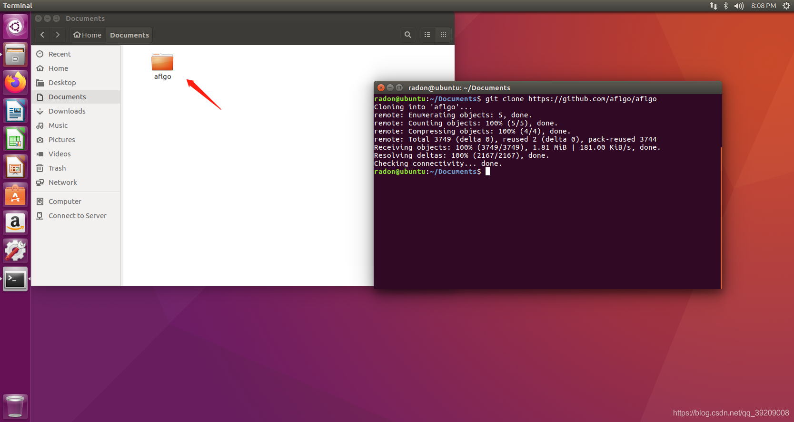

来安装aflgo所需要的部分依赖，执行过程会花费一个多小时

**!! 更新于2021年12月29日：请注意，脚本中会下载并编译LLVM 11.0.0，因此cmake版本至少需要3.13.4才能编译成功，ubuntu自带的cmake版本较低，注意更新**

高版本cmake需要高版本的g++才能编译，这里选择用g++10:

```bash
# 安装g++-10
sudo add-apt-repository ppa:ubuntu-toolchain-r/test
sudo apt install g++-10

# 版本管理, 将gcc-10, g++-10设为高优先级
sudo update-alternatives --install /usr/bin/gcc gcc /usr/bin/gcc-7 1
sudo update-alternatives --install /usr/bin/gcc gcc /usr/bin/gcc-10 2
sudo update-alternatives --install /usr/bin/g++ g++ /usr/bin/g++-7 1
sudo update-alternatives --install /usr/bin/g++ g++ /usr/bin/g++-10 2

# 切换g++版本, gcc同理
# sudo update-alternatives --config g++
```

更新cmake版本:

```bash
sudo apt purge cmake
wget https://github.com/Kitware/CMake/releases/download/v3.13.4/cmake-3.13.4.tar.gz
tar zxvf cmake-3.13.4.tar.gz
cd cmake-3.13.4
sudo ./bootstrap
sudo make
sudo make install
cmake  --version
```

拷贝完成后，进入/aflgo/scripts/build目录下，打开终端并执行

```bash
sudo ./aflgo-build.sh
```

脚本执行结束后，发现居然报错了

```
./aflgo-build.sh: line 62: cd: /afl: No such file or directory
```

用gedit打开aflgo-build.sh，发现是在build AFLGo的时候出现的错误

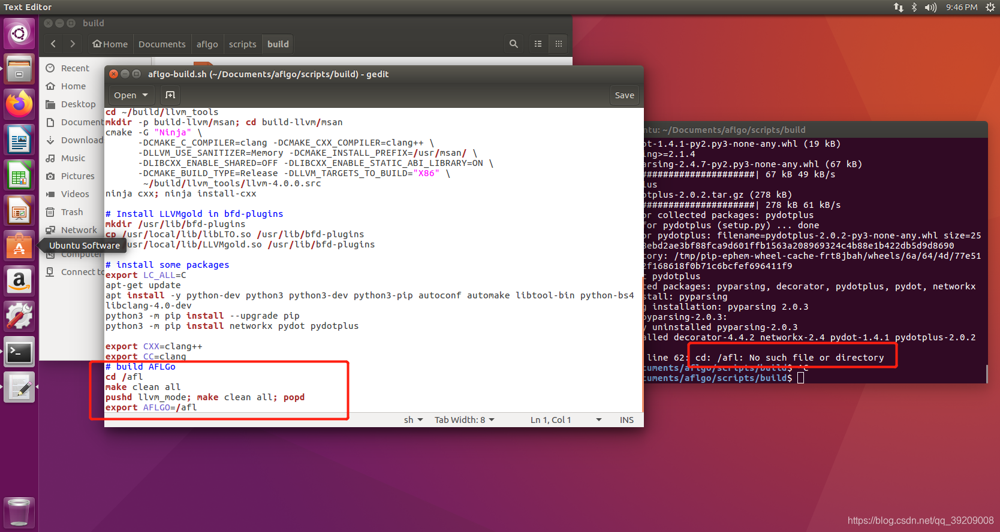

不过没有关系，先不用管这个错误，后续我们会手动build AFLGo
根据github上的教程，我们先安装其他几个依赖，执行下列命令：

```bash
sudo apt-get update
sudo apt-get install python3
sudo apt-get install python3-dev
sudo apt-get install python3-pip
sudo pip3 install --upgrade pip
sudo pip3 install networkx
sudo pip3 install pydot
sudo pip3 install pydotplus
```

回到aflgo所在的目录，笔者这里是回到了Documents目录下，执行下列命令来build AFLGo，也就是上面提到的手动build AFLgo：

```bash
export AFLGO=$PWD/aflgo
pushd $AFLGO
make clean all 
cd llvm_mode
make clean all
popd
```

提示：这里建议新建一个备忘录，因为关闭当前终端后export的相关指令会失效，开启新的终端的话需要重新输入，因此如果当需要新开终端时，直接把备忘录中的export的所有相关指令全都粘贴进去就可以了


然后，下载被测对象文件

```bash
git clone https://gitlab.gnome.org/GNOME/libxml2
export SUBJECT=$PWD/libxml2
```

设置被测对象

```bash
mkdir temp
export TMP_DIR=$PWD/temp
```

执行下面一条命令，获取showlinenum.awk

```bash
wget https://raw.githubusercontent.com/jay/showlinenum/develop/showlinenum.awk
```

可能会出现Unable to establish SSL connection的错误

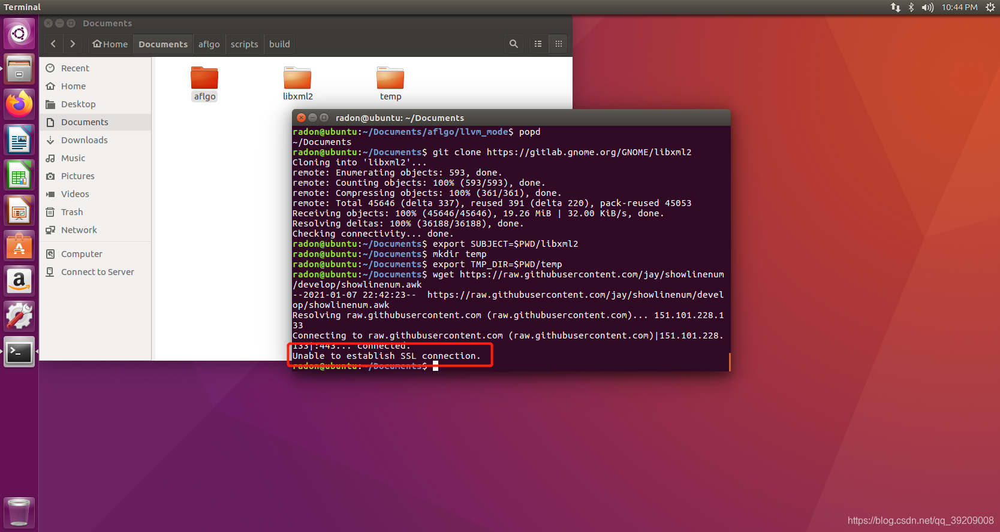

笔者在这里的解决办法是在物理机使用科学上网进入
[https://raw.githubusercontent.com/jay/showlinenum/develop/showlinenum.awk](https://raw.githubusercontent.com/jay/showlinenum/develop/showlinenum.awk)
把其中的内容复制下来，并新建一个txt文件，粘贴进去，再改名为showlinenum.awk，通过共享文件夹的方式把它放到虚拟机中。

这里给放出showlinenum.awk的内容，读者们可以自行复制粘贴。


```awk
#!/bin/sh
#
# Copyright (C) 2013 Jay Satiro <raysatiro@yahoo.com>
# All rights reserved.
#
# This file is part of the showlinenum project.
# https://github.com/jay/showlinenum/
#
# This file is free software: you can redistribute it and/or modify
# it under the terms of the GNU General Public License as published by
# the Free Software Foundation, either version 3 of the License, or
# (at your option) any later version.
#
# This file is distributed in the hope that it will be useful,
# but WITHOUT ANY WARRANTY; without even the implied warranty of
# MERCHANTABILITY or FITNESS FOR A PARTICULAR PURPOSE. See the
# GNU General Public License for more details.
#
# You should have received a copy of the GNU General Public License
# along with this file. If not, see <http://www.gnu.org/licenses/>.
#
#
#
# This gawk script changes the output of git diff to prepend the line number
# for each line.
#
#
#### Usage:
#
# git diff [options] | showlinenum.awk [options]
#
# All options for showlinenum require a value and are specified using the
# format option=value.
#
####
#
#
#### Output:
#
# The diff line output is in this format:
# [path:]<line number>:<diff line>
#
# When the path is shown it's the new version's file path. Line numbers are
# shown for lines in the new version of the file (ie lines that are the same or
# added). If a line appears only in the old version of the file (ie lines
# removed) or the warning indicator is found then padding space is used in
# place of a line number. If a file was removed a tilde ~ is used in place of a
# line number.
#
# The first character in <diff line> is one of four indicators:
# - : Line removed
# + : Line added
# <space> : Line same
# \ : diff warning about previous line
#
# For example:
#  :-removed
# 7:+added
# 8: common
#  :\ No newline at end of file
#
# As far as I know the backslash indicator is only used for the missing newline
# at EOF warning. When that warning appears it applies to the line immediately
# above it. In the example above both the old and new version of the compared
# file are missing the newline at EOF. If the line above a warning is a removed
# line then the warning applies to the old version of the file, and if the line
# above a warning is an added line then the warning applies to the new version
# of the file.
#
# All errors are sent to standard error output (stderr). Currently all errors
# are treated as fatal errors. On fatal error a line that starts with 'FATAL:'
# is followed by script name and error message(s), which may be one or more
# lines. This script then aborts with exit code 1.
#
####
#
#
#### Examples:
#
# Simple example. Line numbers are prepended to git diff's output.
# git diff --cached | showlinenum.awk
#
# This script properly handles the ANSI escape color codes output by git diff.
# To get color output you have to force git diff to send it by passing
# --color=always. When that option is used the color output is always output so
# it is not recommended unless you are either outputting to the terminal or
# somewhere that can properly handle the color codes. Many scripts do not
# function correctly when working with color coded input.
#
# This is the same as the first example, but with color output.
# git diff --color=always --cached | showlinenum.awk
#
# Options can be passed to this script by using awk's -v option or the
# traditional way (shown).
# git diff --color=always HEAD~1 HEAD | showlinenum.awk show_header=0
# git diff --color=always HEAD~1 HEAD | showlinenum.awk show_path=1 show_hunk=0
#
####
#
#
#### Options:
#
# @show_header [0,1] default: 1
# Show diff headers.
#
# Example:
# diff --git a/abc.c b/abc.c
# index 285065f..2471f87 100644
# --- a/abc.c
# +++ b/abc.c
#
##
#
# @show_hunk [0,1] default: ( show_header ? 1 : 0 )
# Show line hunks.
#
# Example: @@ -0,0 +1,17 @@
#
##
#
# @show_path [0,1] default: ( show_header ? 0 : 1 )
# Show paths before line numbers.
#
# Example:
# testdir/file:39:+some added text
#
##
#
# @show_binary [0,1] default: ( show_path ? 1 : 0 )
# Show a binary file that differs in an empty format. [path:][~]:
#
# Binary files have no concept of lines, therefore there is no line number or
# diff line to show that a binary file differs. If the headers are shown you
# can always see whether or not a binary file differs because there will be a
# message "Binary files <old> and <new> differ". If the headers are not shown
# however, that message is suppressed and a binary file that differs has an
# "empty format" with no information, except for a tilde that will be shown if
# the file was removed.
#
# Here are two examples of the empty format, one where the path is shown and
# one where it isn't:
# testdir/binary_file::
# :
#
# Here is an example of a removed binary file, path shown:
# calc.exe:~:
#
##
#
# @allow_colons_in_path [0,1] default: ( show_path ? 0 : 1 )
# Allow colons in path.
#
# If this option is off then abort if a path that contains a colon is
# encountered. That's done to guarantee that this script's diff line output can
# always be parsed with the first colon occurring immediately after the full
# path. Note git diff paths may start with '<commit>:' like HEAD:./foo/bar, and
# for such a path this option would need to be on.
#
##
#
# @color_{line_number,path,separator} <num>[;num][;num]
# Add color to some sections.
#
# Color the respective section using one or more ANSI color codes.
# This is not recommended unless you are outputting to the terminal.
# If semi-colons are present in these options your shell may need them quoted.
# Example: "color_line_number=1;37;45" is bright white foreground (1;37) on
# purple background (45).
#
####
#


{
# This code block is compatible with both the bourne shell and gawk. If this
# gawk script is being interpreted by the bourne shell then gawk is executed to
# become its interpreter.
LAUNCHER="" "exec" "gawk" "-f" "$0" "$@"
}


function reset_header_variables()
{
  parsing_diff_header = 0;
  found_path = 0;
  path = 0;
  found_oldfile_path = 0;
  oldfile_path = 0;
  found_line = 0;
  line = 0;
  found_diff = 0;
  diff = 0;
}

function init()
{
  reset_header_variables();

  # To determine whether or not a variable was defined on the command line and
  # is not an empty string it must be tested. Many versions of gawk will show a
  # warning if using option --lint and an undefined variable is evaluated.
  # Therefore this workaround to force define some variables as a string by
  # appending an empty string.

  # String variables.
  color_line_number = color_line_number "";
  color_path = color_path "";
  color_separator = color_separator "";

  die_if_bad_color(color_line_number);
  die_if_bad_color(color_path);
  die_if_bad_color(color_separator);

  # Bool variables are later converted back to a number by get_bool().
  show_header = show_header "";
  show_hunk = show_hunk "";
  show_path = show_path "";
  show_binary = show_binary "";
  allow_colons_in_path = allow_colons_in_path "";

  # Return the variable as a bool value unless it is empty then return its
  # default bool value.
  show_header = get_bool(show_header, 1);
  show_hunk = get_bool(show_hunk, (show_header ? 1 : 0));
  show_path = get_bool(show_path, (show_header ? 0 : 1));
  show_binary = get_bool(show_binary, (show_path ? 1 : 0));
  allow_colons_in_path = get_bool(allow_colons_in_path, (show_path ? 0 : 1));
}

function FATAL(a_msg)
{
  print "";
  # Apparently there is no portable way to get this script's name at runtime?
  print strip_ansi_color_codes("FATAL: showlinenum: " a_msg) > "/dev/stderr";
  exit 1;
}

# this returns the bool numeric value of 'input' if it contains a numeric or
# string bool value, otherwise it returns the numeric value of default_value.
function get_bool(input, a_default_value)
{
  if(a_default_value !~ /^[0-1]$/)
  {
    errmsg = "get_bool(): a_default_value must be a bool value." \
             "\n" "a_default_value: " a_default_value;
    FATAL(errmsg);
  }

  regex = "^[[:blank:]]*([0-1])[[:blank:]]*$";
  if(input ~ regex)
  {
    return gensub(regex, "\\1", 1, input) + 0;
  }

  return a_default_value + 0;
}

function die_if_bad_color(input)
{
  if(input ~ /[^0-9;]/)
  {
    errmsg = "die_if_bad_color(): color parameters may contain only numbers " \
             "and semi-colons.";
    FATAL(errmsg);
  }
}

# Fix an extracted path.
# eg '+++ b/foo/bar' the input is 'b/foo/bar' and the output is 'foo/bar'
function fix_extracted_path(input)
{
  if(input == "/dev/null")
  {
    return input;
  }

  if(input !~ /^\042?[ab]\//)
  {
    errmsg = "fix_extracted_path(): sanity check failed, expected a/ or b/ " \
             "prefix." \
             "\n" "Path: " input;
    FATAL(errmsg);
  }

  if(!allow_colons_in_path && (input ~ /:/))
  {
    errmsg = "fix_extracted_path(): colons in path are forbidden ";
    if(show_path)
    {
      errmsg = errmsg "by default when show_path is on in deference to " \
               "scripts which may parse this script's output and rely on " \
               "the colon as a separator. To override use command line " \
               "option allow_colons_in_path=1.";
    }
    else
    {
      errmsg = errmsg "because allow_colons_in_path is off.";
    }
    errmsg = errmsg "\n" "Path: " input;
    FATAL(errmsg);
  }

  # Remove an erroneous trailing tab that git diff can add to some non-binary
  # paths. eg an unquoted 'b/a $b	' becomes 'b/a $b' if the diff line only
  # contains the latter.
  if((input ~ /\t$/) && !index(diff, input) && \
     index(diff, substr(input, 1, length(input) - 1)))
  {
    sub(/\t$/, "", input);
  }

  sub(/[ab]\//, "", input);

  return input;
}

# this returns a string with the ansi color codes removed
function strip_ansi_color_codes(input)
{
  return gensub(/\033\[[0-9;]*m/, "", "g", input);
}

function print_separator(a_separator)
{
  if(color_separator)
  {
    printf "\033[%sm%s\033[m", color_separator, a_separator;
  }
  else
  {
    printf "%s", a_separator;
  }
}

function print_line_number(a_line_number)
{
  if(color_line_number)
  {
    printf "\033[%sm", color_line_number;
  }

  if(a_line_number ~ /^[0-9]+$/)
  {
    # Awk stores all integers internally as floating point. If printf is passed
    # an integer it is allowed convert it to scientific notation which I don't
    # want for line numbers. I'm not sure how relevant that is since it seems
    # to vary between different versions of awk and only when the integer is
    # large (how large?).
    # The 'f' type specifier should show [-9007199254740992, 9007199254740992]
    printf "%.0f", a_line_number + 0;
  }
  else
  {
    printf "%s", a_line_number;
  }

  if(color_line_number)
  {
    printf "\033[m";
  }

  print_separator(":");
}

function print_path(a_path)
{
  if(!show_path)
  {
    return;
  }

  if(color_path)
  {
    printf "\033[%sm%s\033[m", color_path, a_path;
  }
  else
  {
    printf "%s", a_path;
  }

  print_separator(":");
}

#
# main
#
{
  if(NR == 1)
  {
    init();
  }

  if($0 ~ /^(\033\[[0-9;]*m)*diff /)
  {
    reset_header_variables();
    parsing_diff_header = 1;

    diff = strip_ansi_color_codes($0);
    found_diff = 1;

    if(show_header)
    {
      print;
    }

    next;
  }

  # check for combined diff line info
  if($0 ~ /^(\033\[[0-9;]*m)*@@@+ /)
  {
    FATAL("Combined diff format not supported.");
  }

  # check for diff line info
  if($0 ~ /^(\033\[[0-9;]*m)*@@ /)
  {
    line = 0;
    found_line = 0;
    parsing_diff_header = 0;

    if(!found_path || !found_oldfile_path)
    {
      FATAL("Line info found before path info.");
    }

    stripped = strip_ansi_color_codes($0);

    regex = "^@@ -[0-9]+(,[0-9]+)? \\+([0-9]+)(,[0-9]+)? @@.*$";
    if(stripped ~ regex)
    {
      line = gensub(regex, "\\2", 1, stripped);
      # Adding zero to line converts it from a string to an integer.
      # That only works when all color codes have been removed.
      line = line + 0;
      found_line = 1;
    }

    if(!found_line)
    {
      errmsg = "Unrecognized hunk info.";
      if(path == "/dev/null")
      {
        errmsg = errmsg "\n" "Removed file: " oldfile_path;
      }
      else
      {
        errmsg = errmsg "\n" "File: " path;
      }
      errmsg = errmsg "\n" "File's hunk info: " stripped;
      FATAL(errmsg);
    }

    if(show_hunk)
    {
      print;
    }

    next;
  }

  if(parsing_diff_header)
  {
    stripped = strip_ansi_color_codes($0);

    # Check for oldfile path
    regex = "^\\-\\-\\- (\\042?a\\/.+|\\/dev\\/null)$";
    if(stripped ~ regex)
    {
      oldfile_path = fix_extracted_path(gensub(regex, "\\1", 1, stripped));
      found_oldfile_path = 1;

      if(show_header)
      {
        print;
      }

      next;
    }

    # Check for newfile path
    regex = "^\\+\\+\\+ (\\042?b\\/.+|\\/dev\\/null)$";
    if(stripped ~ regex)
    {
      path = fix_extracted_path(gensub(regex, "\\1", 1, stripped));
      found_path = 1;

      if(show_header)
      {
        print;
      }

      next;
    }

    # Check for binary old/newfile path
    regex = "^Binary files (.*) differ$";
    if(stripped ~ regex)
    {
      path = gensub(regex, "\\1", 1, stripped);

      found_path = 0;
      found_oldfile_path = 0;

      # Check for binary oldfile path.
      # The oldfile path only needs to be set if newfile is /dev/null (deleted
      # or moved file).
      if(match(path, / and \/dev\/null$/))
      {
        oldfile_path = substr(path, 1, length(path) - RLENGTH);

        if((oldfile_path ~ /^\042?a\//) && index(diff, oldfile_path))
        {
          oldfile_path = fix_extracted_path(oldfile_path);
          found_oldfile_path = 1;
          path = "/dev/null";
          found_path = 1;
        }
      }

      # This gets the path for a binary file by digging through the first line
      # of the diff header ('diff') and the binary file notice line
      # ('stripped') to find the longest rightmost match between the two.
      while(!found_path && match(path, /and \042?b\/.+$/))
      {
        path_len = RLENGTH - 4;
        path = substr(path, RSTART + 4, path_len);

        diff_rstart = (length(diff) + 1) - path_len;
        if(diff_rstart < 1)
        {
          continue;
        }

        if(path == substr(diff, diff_rstart, path_len))
        {
          path = fix_extracted_path(path);
          found_path = 1;
          break;
        }
      }

      if(show_header)
      {
        print;
      }

      if(!found_path && !found_oldfile_path)
      {
        errmsg = "Path info for binary file not found in header lines." \
                 "\n" "Diff line: " diff \
                 "\n" "Current line: " stripped;
        FATAL(errmsg);
      }

      if(show_binary)
      {
        if(found_oldfile_path)
        {
          # Binary file removed: path/to/foo:~:
          print_path(oldfile_path);
          print_line_number("~");
        }
        else
        {
          # Binary file differs: path/to/foo::
          print_path(path);
          print_line_number("");
        }

        print "";
      }

      reset_header_variables();
      next;
    }

    if(show_header)
    {
      print;
    }

    next;
  }

  if(!found_path || !found_oldfile_path)
  {
    FATAL("Path info not found.");
  }

  if(!found_line)
  {
    FATAL("Line info not found.");
  }

  if(path == "/dev/null")
  {
    if($0 !~ /^(\033\[[0-9;]*m)*[\\-]/)
    {
      errmsg = "Expected negative or backslash indicator for removed file's " \
               "diff line." \
               "\n" "Removed file: " oldfile_path \
               "\n" "File's diff line: " $0;
      FATAL(errmsg);
    }

    # File removed: path/to/foo:~:
    print_path(oldfile_path);
    print_line_number("~");

    print;
    next;
  }


  # Extract the indicator. Unfortunately early versions of gawk (like the one
  # included with git for Windows) do not support an array parameter for
  # match() so the indicator must be extracted on success by using substr().

  if(($0 !~ /^(\033\[[0-9;]*m)*[\\ +-]/) || \
     !match($0, /[\\ +-]/) || (RLENGTH != 1))
  {
    errmsg = "Failed to extract indicator from diff line." \
             "\n" "File: " path \
             "\n" "File's diff line: " $0;
    FATAL(errmsg);
  }

  indicator = substr($0, RSTART, RLENGTH);

  if((indicator == "+") || (indicator == " "))
  {
    print_path(path);
    print_line_number(line++);
  }
  else if((indicator == "-") || (indicator == "\\"))
  {
    print_path(path);
    # Fill the line number section with padding.
    print_line_number(sprintf("%" length((line + 1) "") "s", " "));
  }
  else
  {
    errmsg = "Unexpected diff line indicator." \
             "\n" "Indicator: " indicator \
             "\n" "File: " path \
             "\n" "File's diff line: " $0;
    FATAL(errmsg);
  }

  print;
}
```


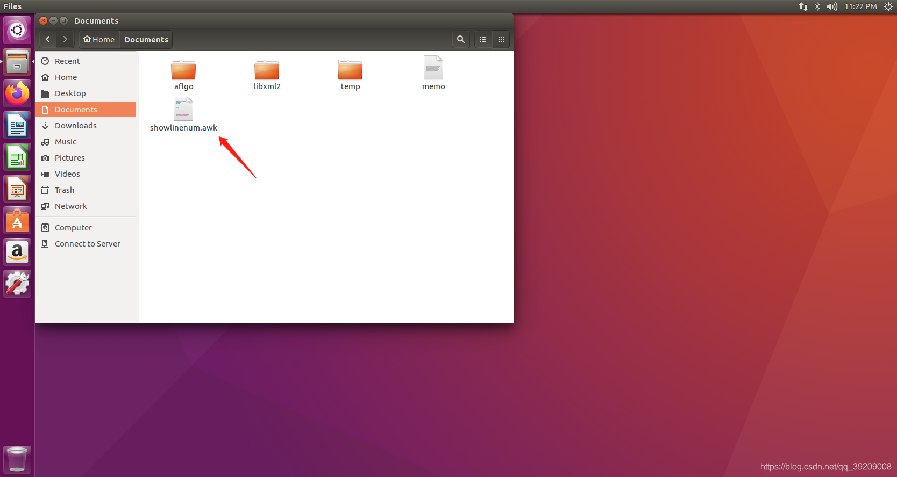

根据github的教程，继续执行下列命令：

```bash
chmod +x showlinenum.awk
mv showlinenum.awk $TMP_DIR
```

```bash
pushd $SUBJECT
git checkout ef709ce2
git diff -U0 HEAD^ HEAD > $TMP_DIR/commit.diff
popd
```

执行下面的命令后，提示gawk: not found

```bash
cat $TMP_DIR/commit.diff |  $TMP_DIR/showlinenum.awk show_header=0 path=1 | grep -e "\.[ch]:[0-9]*:+" -e "\.cpp:[0-9]*:+" -e "\.cc:[0-9]*:+" | cut -d+ -f1 | rev | cut -c2- | rev > $TMP_DIR/BBtargets.txt
```

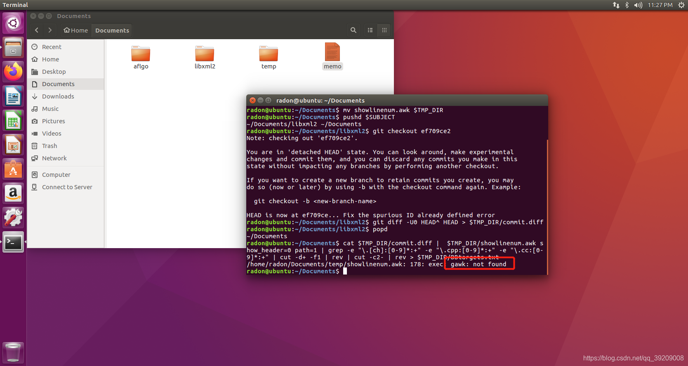

这好说，没什么咱就装什么：

```bash
sudo apt install gawk
```

装好gawk后再执行上一条命令，发现temp文件夹下的BBtargets.txt成功生成了，如图

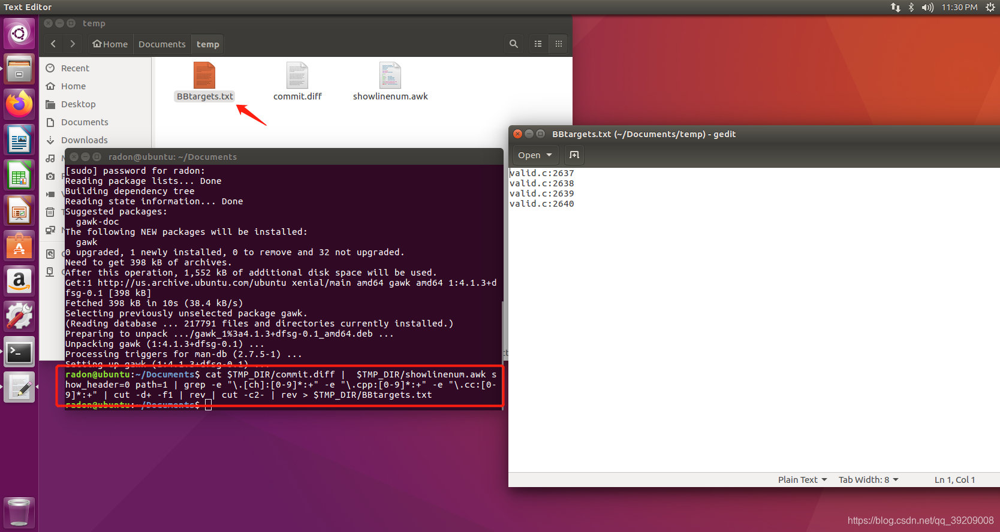

根据github的教程，继续执行下列指令：

```bash
export CC=$AFLGO/afl-clang-fast
export CXX=$AFLGO/afl-clang-fast++
export COPY_CFLAGS=$CFLAGS
export COPY_CXXFLAGS=$CXXFLAGS
export ADDITIONAL="-targets=$TMP_DIR/BBtargets.txt -outdir=$TMP_DIR -flto -fuse-ld=gold -Wl,-plugin-opt=save-temps"
export CFLAGS="$CFLAGS $ADDITIONAL"
export CXXFLAGS="$CXXFLAGS $ADDITIONAL"
export LDFLAGS=-lpthread

pushd $SUBJECT
./autogen.sh
./configure --disable-shared
make clean
make all
popd
```

如果步骤未出错的话，在make all 时，可以看到很多的(yeah!)

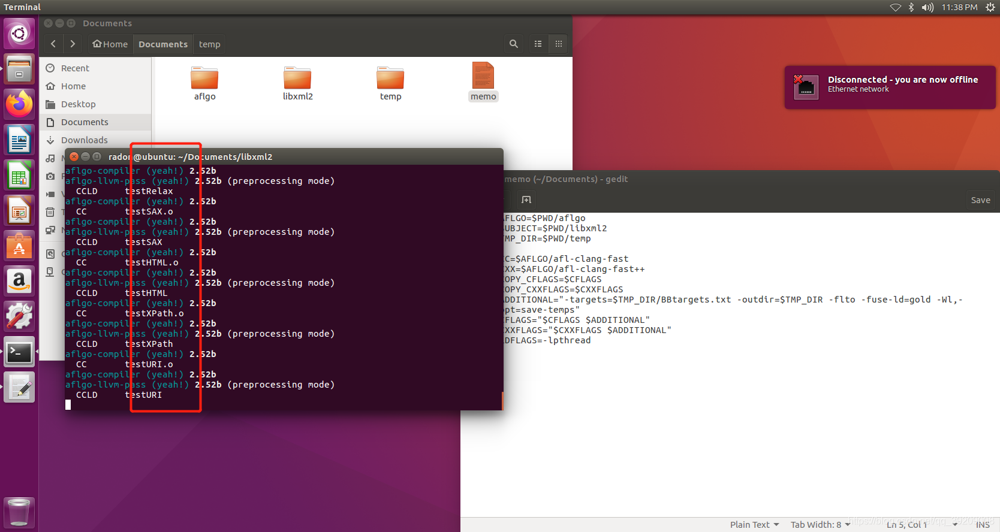

执行下列命令，效果如图：

```bash
$SUBJECT/xmllint --valid --recover $SUBJECT/test/dtd3
ls $TMP_DIR/dot-files
echo "Function targets"
cat $TMP_DIR/Ftargets.txt
```

可以看到生成了很多dot文件用于表示调用图或控制流图

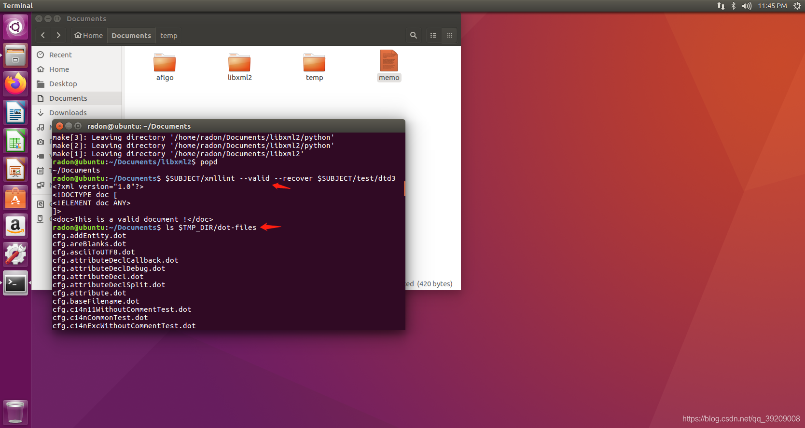

Ftargets.txt也成功生成了

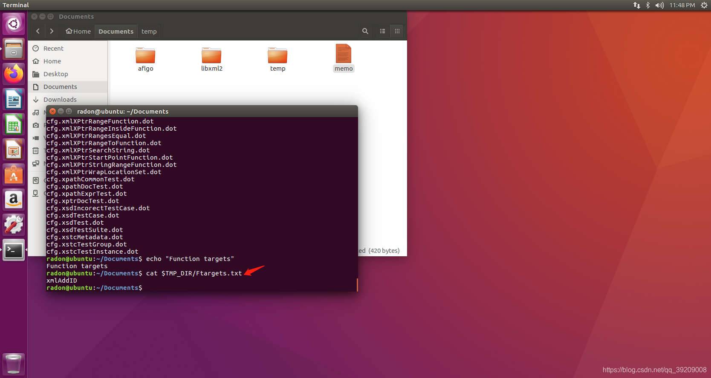

根据教程，继续执行命令：

```bash
cat $TMP_DIR/BBnames.txt | rev | cut -d: -f2- | rev | sort | uniq > $TMP_DIR/BBnames2.txt && mv $TMP_DIR/BBnames2.txt $TMP_DIR/BBnames.txt
cat $TMP_DIR/BBcalls.txt | sort | uniq > $TMP_DIR/BBcalls2.txt && mv $TMP_DIR/BBcalls2.txt $TMP_DIR/BBcalls.txt
```

下面这一步会花费的时间非常久，可以找点别的事情做等待计算完成：

```bash
$AFLGO/scripts/genDistance.sh $SUBJECT $TMP_DIR xmllint
```

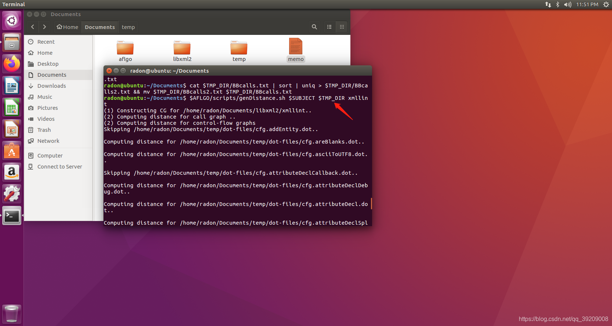

完成后看看distance.cfg.txt里有没有内容：

```bash
echo "Distance values:"
head -n5 $TMP_DIR/distance.cfg.txt
echo "..."
tail -n5 $TMP_DIR/distance.cfg.txt
```

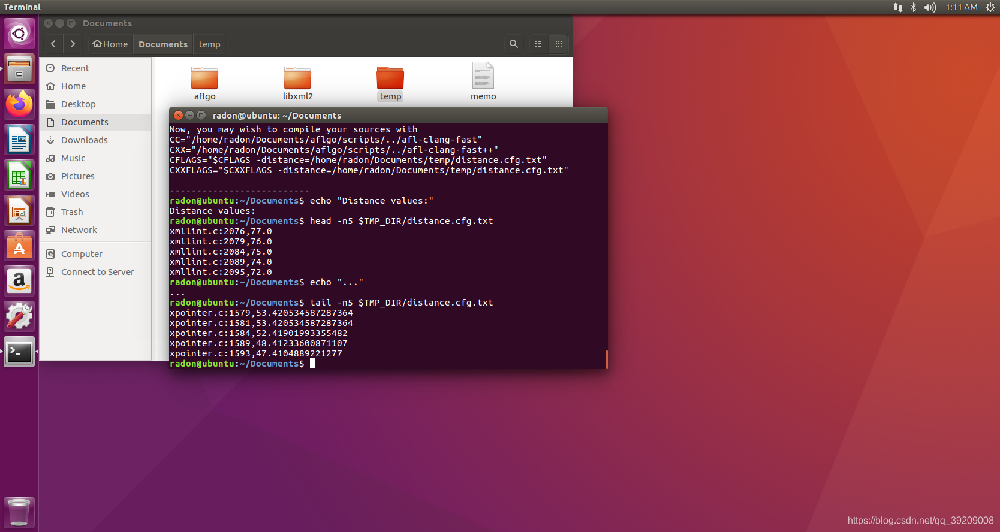

对项目进行插桩：

```bash
export CFLAGS="$COPY_CFLAGS -distance=$TMP_DIR/distance.cfg.txt"
export CXXFLAGS="$COPY_CXXFLAGS -distance=$TMP_DIR/distance.cfg.txt"
pushd $SUBJECT
make clean
./configure --disable-shared
make all
popd
```

如果运行顺利，你会在终端上看到很多的(yeah!)，就像之前提到过的那样。

建立测试用例的文件夹，官方的步骤是：

```bash
mkdir in
cp $SUBJECT/test/dtd* in
cp $SUBJECT/test/dtds/* in
```

这里的第二步有错误，如果按照官方说的来，会提示你：

```
cp: omitting directory '/home/radon/Documents/libxml2/test/dtds'
```

正确的指令为：

```bash
mkdir in
cp -r $SUBJECT/test/dtd* in
cp $SUBJECT/test/dtds/* in
```

最后，执行下面一条指令开始用AFLGo进行模糊测试，但是却提示错误！

```bash
$AFLGO/afl-fuzz -S ef709ce2 -z exp -c 45m -i in -o out $SUBJECT/xmllint --valid --recover @@
```

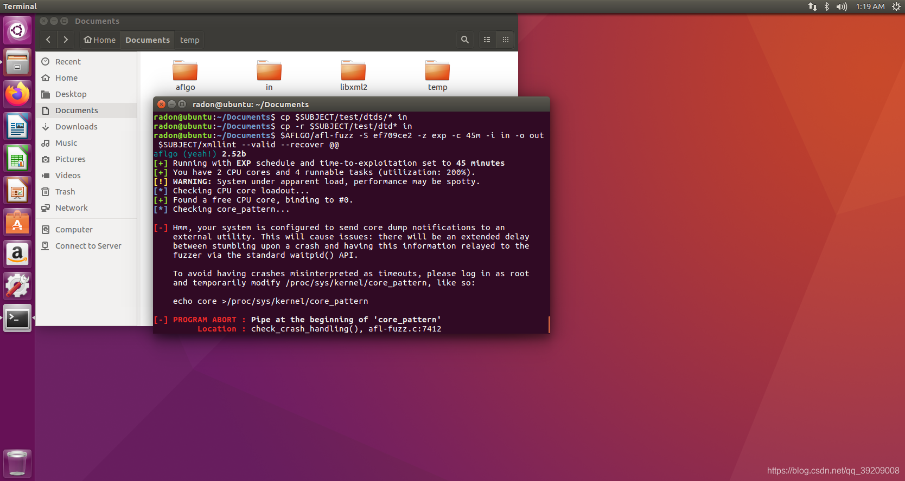

看他的意思，是想让我们以管理员权限执行

```bash
echo core >/proc/sys/kernel/core_pattern
```

那么就试试吧，以执行下列命令：

```bash
sudo su
echo core >/proc/sys/kernel/core_pattern
exit
```

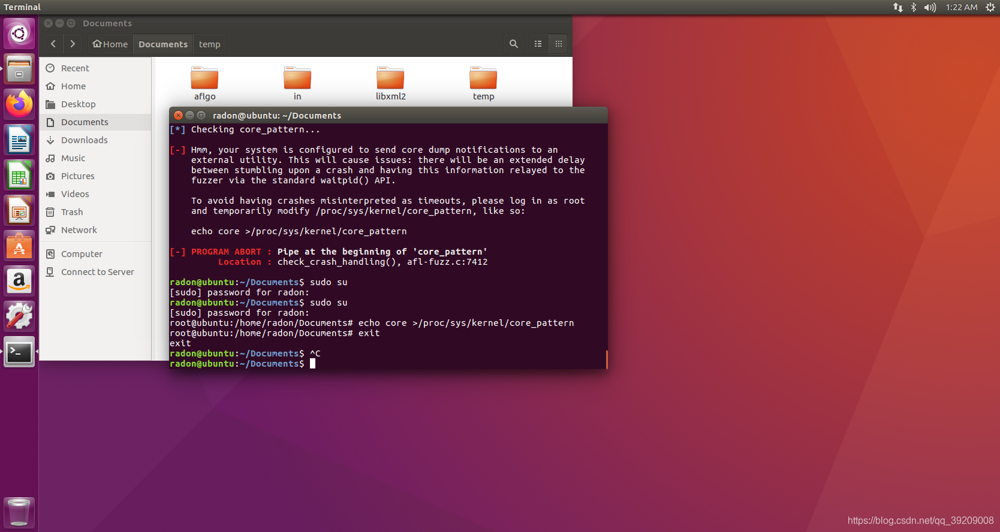

好了，终于可以用AFLGo进行测试了，再次输入模糊测试的指令可能会出错，不过没事，加上-t 2000+就可以了！

```bash
$AFLGO/afl-fuzz -S ef709ce2 -z exp -c 45m -i in -o out -t 2000+ $SUBJECT/xmllint --valid --recover @@
```

效果如图所示

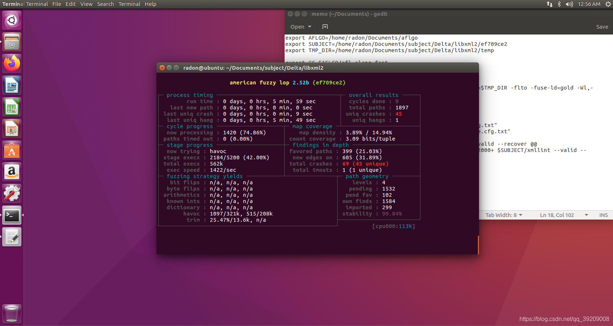

如果想用原版AFL的话，可以执行下列命令（记得先设置好AFL的路径）：

```bash
$AFL/afl-fuzz -M master -i in -o out -t 2000+ $SUBJECT/xmllint --valid --recover @@
```

AFLGo的安装与使用就结束了，笔者近期会研究一下如何对其他的项目运用AFLGo进行模糊测试。

如果有问题的话，欢迎讨论。

## 参考资料

[1] [https://github.com/aflgo/aflgo](https://github.com/aflgo/aflgo)

[2] Marcel Böhme, Van-Thuan Pham, Manh-Dung Nguyen, and Abhik Roychoudhury. 2017. Directed Greybox Fuzzing. In Proceedings of the 2017 ACM SIGSAC Conference on Computer and Communications Security (CCS '17). Association for Computing Machinery, New York, NY, USA, 2329–2344. DOI:https://doi.org/10.1145/3133956.3134020
