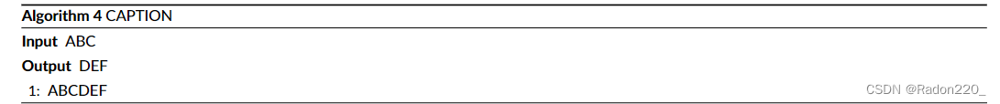
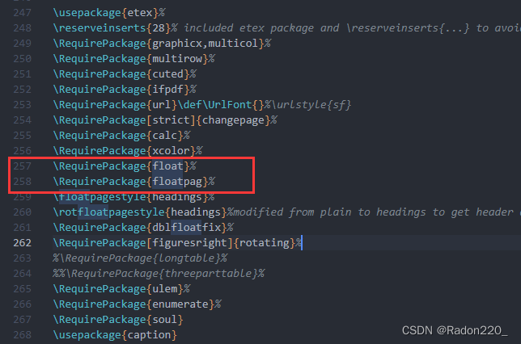
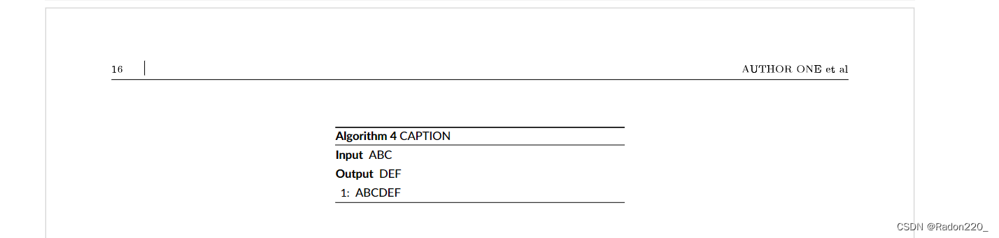

最近在用Latex写文章（模板为WileyNJD-v2），发现自己的算法每行内容不是很长，导致右边出现大片的空白，例如下面这种情况：



看着感觉有些难受，于是想让算法减少一下宽度并居中。百度解决方案后发现推荐的解决方案是将算法的浮动选项设置为[H]，并将其放入minipage来控制宽度，代码大致如下：

```latex
\begin{minipage}{7cm}
\begin{algorithm}[H]
  \caption{CAPTION}\label{myalg}
  \renewcommand{\algorithmicrequire}{\textbf{Input}}
  \renewcommand{\algorithmicensure}{\textbf{Output}}
  \begin{algorithmic}[1]
    \Require ABC
    \Ensure DEF
    \State ABCDEF
  \end{algorithmic}
\end{algorithm}
\end{minipage}
```

但是这样写的话Latex会报错：

```
Not in outer par mode.
```

出现这个错误的原因是，Latex认为我们没有将算法的浮动选项设置为H，如果去掉外层的minipage后，报的错误就是这个：

```
Unknown float option `H'.
```

[H]是出自float包的一个选项，但奇怪的是，WileyNJD-v2.cls中明明引入了float包，为什么还不能使用这个浮动选项呢？

经过一段时间的探索后，发现cls文件中引入float包那里是这样写的：



查找了一下原因，发现float和floatpag之间是有冲突的，正是因为有这个冲突才导致浮动选项H无法被识别

解决方案就是：将cls文件中，引入float包的语句挪到引入floatpag下面。
再回到tex文件中，结合minipage和[H]就可以来缩减算法的宽度了，还可以配合\centerline让算法居中，变得更美观一些。

```latex
\centerline{
  \begin{minipage}{7cm}
    \begin{algorithm}[H]
      \caption{CAPTION}\label{myalg}
      \renewcommand{\algorithmicrequire}{\textbf{Input}}
      \renewcommand{\algorithmicensure}{\textbf{Output}}
      \begin{algorithmic}[1]
        \Require ABC
        \Ensure DEF
        \State ABCDEF
      \end{algorithmic}
    \end{algorithm}
  \end{minipage}
}
```


