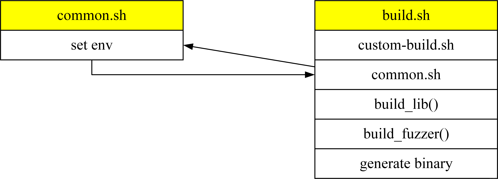
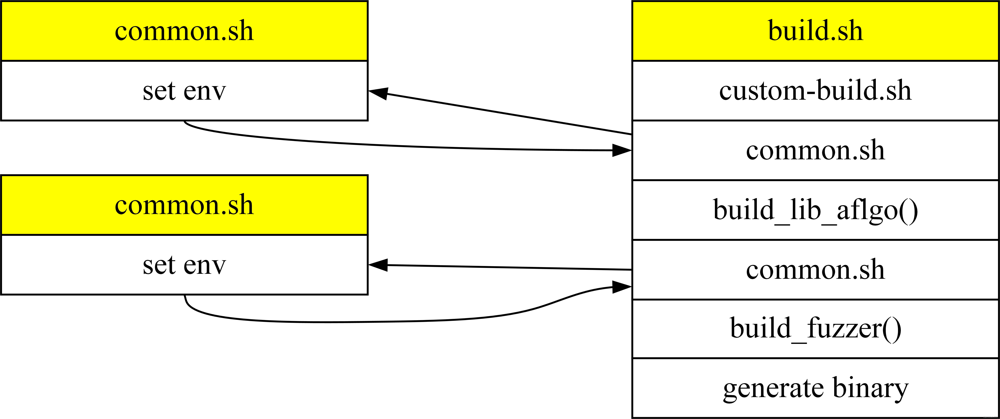

## 前言

谷歌的模糊测试套件（fuzzer-test-suite，以下简称为FTS）是一组可以用于模糊测试的benchmarks，其中包含了20多个被测项目。目前支持使用AFL、libfuzzer等工具进行测试。

我在[之前的一篇博文](/blog/2021/01/08/aflgo-install-and-usage/)中介绍了一下AFLGo的安装和对libxml2进行测试的过程，既然FTS支持使用AFL进行测试，那么使用基于AFL的AFLGo对FTS进行测试理论上也是可以做到的。不过由于篇幅以及被测项目的一些因素限制，这篇博文仅会介绍一下将AFLGo应用于FTS中的boringssl-2016-02-12的过程。其他项目的测试过程其实也类似，但是其他项目的测试目标不太好确定，所以本篇文章仅介绍一下相对好确定目标的boringssl项目。

## 一、下载FTS

直接选个合适的地方git clone就可以了。

```bash
git clone https://github.com/google/fuzzer-test-suite.git
```

根据[博文2](https://blog.csdn.net/weixin_39368364/article/details/116782887)可知，对boringssl进行测试前需要先安装一些东西：

```bash
sudo apt-get update
sudo apt-get install -y build-essential
sudo apt-get install cmake
sudo add-apt-repository ppa:longsleep/golang-backports
sudo apt-get update
sudo apt-get install golang-go
```

如果要使用AFL对其进行测试的话，需要先将在common.sh中将`FUZZ_ENGINE`改为`afl`，并将common.sh中的`AFL_SRC`改为自己电脑中AFL的位置，`LIBFUZZER_SRC`改为libfuzzer-workshop/libFuzzer/Fuzzer所在位置。然后，在boringssl-2016-02-12文件夹中创建个文件夹，在新建文件夹的内部执行build.sh就可以了：

```bash
cd /path/to/fuzzer-test-suite/boringssl-2016-02-12
mkdir test    # 记得先修改common.sh中的FUZZ_ENGINE、LIBFUZZER_SRC和AFL_SRC
cd test
$(dirname $PWD)/build.sh    # 这里用../build.sh也是可以的，但是生成的可执行文件名字会变成..-afl
```

## 二、将AFLGo应用于FTS

首先，我们需要看一下boringssl-2016-02-12文件夹下的build.sh的内容来决定在哪些脚本中进行更改。从脚本中可以看出，第4行与第5行分别调用了脚本custom-build.sh与common.sh。不过custom-build.sh与我们要做的事情关系不大，所以可以先暂时不管他。我们接下来主要是修改common.sh与build.sh。

在修改脚本前，我们要了解一下FTS中几个脚本的工作流程，以免出现错误导致被测程序构建失败。boringssl-2016-02-12中的build.sh流程如下图所示。在custom-build.sh与common.sh中会设置一些环境变量，然后根据这些环境变量来build被测对象、build fuzzer与生成二进制文件。



### 1. 修改common.sh

原本的FTS是不支持AFLGo的，所以我们要在脚本中添加一些东西来支持AFLGo运行。在common.sh的`POSSIBLE_FUZZING_ENGINE`中添加aflgo即可，将上一行的`FUZZING_ENGINE`的值也改为aflgo。

既然都向`POSSIBLE_FUZZING_ENGINE`中添加aflgo了，那么我们也需要添加一下aflgo的所在位置。向common.sh中添加（笔者将这条指令添加到了`AFL_SRC`的下一行）：

```bash
AFLGO_SRC=${AFLGO_SRC:-/home/radon/Documents/fuzzing/fuzzers/aflgo}
```

从原本的工作流程中可知，build_fuzzer这个函数是必然会执行的，并且从build_fuzzer函数中可以看出，脚本会根据你指定的`FUZZING_ENGINE`来调用相应的`build_${FUZZING_ENGINE}`函数。比如如果你指定的`FUZZING_ENGINE`是afl的话，它会调用build_afl函数；如果是libfuzzer的话，会调用build_libfuzzer函数，我们现在将`FUZZING_ENGINE`指定为了aflgo，而脚本中没有build_aflgo的函数，所以我们要手动写一下（将下面这段代码写到一个合适的地方就好）：

```bash
build_aflgo() {
  $CC $CFLAGS -c -w $AFLGO_SRC/llvm_mode/afl-llvm-rt.o.c
  $CXX $CXXFLAGS -std=c++11 -O2 -c ${LIBFUZZER_SRC}/afl/afl_driver.cpp -I$LIBFUZZER_SRC
  ar r $LIB_FUZZING_ENGINE afl_driver.o afl-llvm-rt.o.o
  rm *.o
}
```

至此，common.sh的内容就修改完毕了。

### 2. 修改build.sh

用过AFLGo的各位应该知道，我们需要把编译器设置为aflgo文件夹下的aflgo-clang-fast并对被测项目进行编译构建才可以成功进行控制流图的生成与插桩。所以，一个简单的办法是，我们在build_lib中设置好aflgo的环境变量，生成控制流图并计算距离，然后根据距离信息进行程序插桩，当这些都结束后，我们先删除自己搞得环境变量，再调用一下common.sh重新换回FTS设置的环境变量，来进行后续的步骤。



AFLGo在测试开始前需要生成被测项目的调用图与控制流图，并且还需要根据目标基本块计算其他基本块的距离信息，然后再把距离信息插入被测程序，以达到定向模糊测试的效果。因此，AFLGo需要对被测项目build两次，第一次是生成控制流图等信息，第二次则是根据距离信息进行插桩，在已有的build_lib函数上进行更改会导致改动较大，因此建议在build.sh中添加一个函数build_lib_aflgo，具体内容如下：

```bash
build_lib_aflgo() {
  rm -rf BUILD
  cp -rf SRC BUILD

  # 临时设置一下AFLGo可能用到的环境变量
  rm -rf temp
  mkdir temp
  export TMP_DIR=$PWD/temp
  export SUBJECT=$PWD/BUILD
  export CC=$AFLGO_SRC/afl-clang-fast
  export CXX=$AFLGO_SRC/afl-clang-fast++
  export CFLAGS="-targets=$TMP_DIR/BBtargets.txt -outdir=$TMP_DIR -flto -fuse-ld=gold -Wl,-plugin-opt=save-temps"
  export CXXFLAGS="$CFLAGS"

  # 根据FTS中提供的crash文件，我们将crash发生位置所在的基本块设置为目标
  echo "asn1_lib.c:459" >$TMP_DIR/BBtargets.txt

  # AFLGo的预处理
  (cd BUILD && cmake -DBUILD_SHARED_LIBS=OFF -DCMAKE_C_COMPILER="$CC" -DCMAKE_C_FLAGS="$CFLAGS -Wno-deprecated-declarations" -DCMAKE_CXX_COMPILER="$CXX" -DCMAKE_CXX_FLAGS="$CXXFLAGS -Wno-error=main" && make -j $JOBS)
  cat $TMP_DIR/BBnames.txt | rev | cut -d: -f2- | rev | sort | uniq >$TMP_DIR/BBnames2.txt && mv $TMP_DIR/BBnames2.txt $TMP_DIR/BBnames.txt
  cat $TMP_DIR/BBcalls.txt | sort | uniq >$TMP_DIR/BBcalls2.txt && mv $TMP_DIR/BBcalls2.txt $TMP_DIR/BBcalls.txt

  # 计算并生成距离文件
  $AFLGO_SRC/scripts/genDistance.sh $SUBJECT $TMP_DIR
  export CFLAGS="-distance=$TMP_DIR/distance.cfg.txt"
  export CXXFLAGS="$CFLAGS"

  # 设置好参数后根据距离信息进行程序插桩
  (cd BUILD && cmake -DBUILD_SHARED_LIBS=OFF -DCMAKE_C_COMPILER="$CC" -DCMAKE_C_FLAGS="$CFLAGS -Wno-deprecated-declarations" -DCMAKE_CXX_COMPILER="$CXX" -DCMAKE_CXX_FLAGS="$CXXFLAGS -Wno-error=main" && make -j $JOBS)

  # 删除变量
  unset CC CXX CFLAGS CXXFLAGS
}
```

由于我们新加了一个build_lib_aflgo函数，所以需要在原先的build_lib地方稍微调整一下，好方便我们调用这个函数。

```bash
# 如果FUZZING_ENGINE是aflgo的话，就调用我们写的函数
if [[ $FUZZING_ENGINE == "aflgo" ]]; then
  build_lib_aflgo
else  # 如果不是的话，就调用原本的build_lib函数
  build_lib
fi

# 第二次调用common.sh，重新设置下环境变量
. $(dirname $0)/../common.sh
build_fuzzer
```

### 3. 开始测试

终于来到最后了，设置好aflgo的路径后，使用aflgo/afl-fuzz开始测试就可以了，初始测试用例可以用FTS里帮你选好的seeds（二进制文件同目录下FTS会帮我们建一个seeds文件夹）

```bash
export AFLGO=/path/to/aflgo    # 设置好你的aflgo路径
$AFLGO/afl-fuzz -i seeds -o out -m none -z exp -c 45m -d ./boringssl-2016-02-12-aflgo @@
```

FTS中用的是persistent mode进行的模糊测试。

## 总结

以上就是本文的全部内容了。本文简单介绍了一下将AFLGo应用于FTS中boringssl项目的使用流程，如果要将AFLGo应用于其他项目的话还是有很多要解决的问题，例如目标点该如何设置，遇到C++项目又该如何计算距离，后续有机会的话会对每个项目的修改流程做一下简单的介绍。
