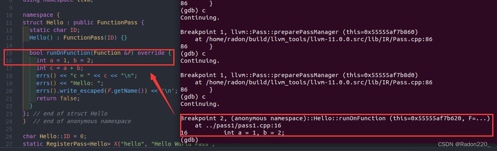
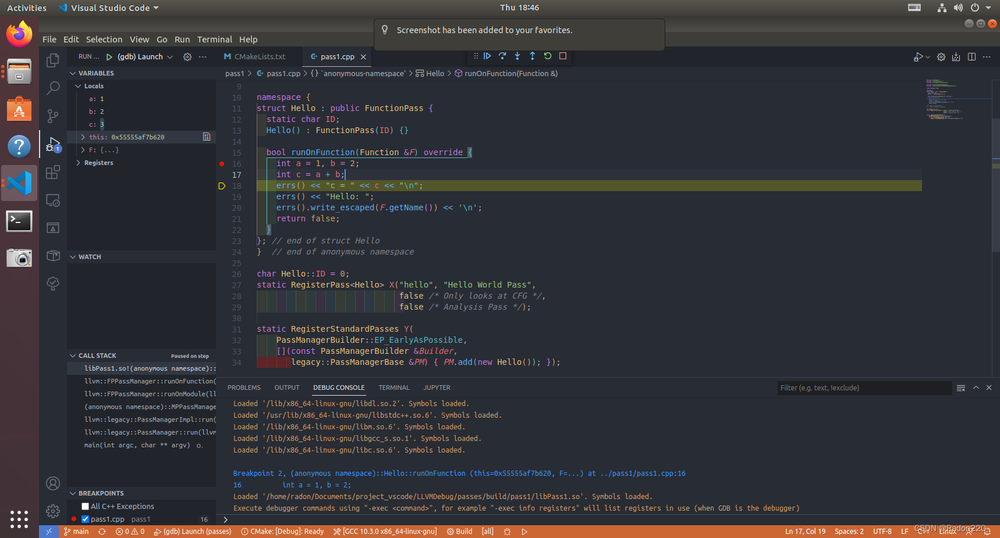
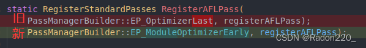
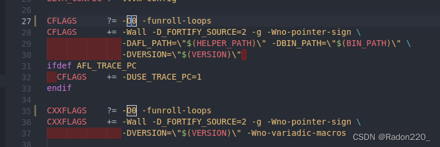
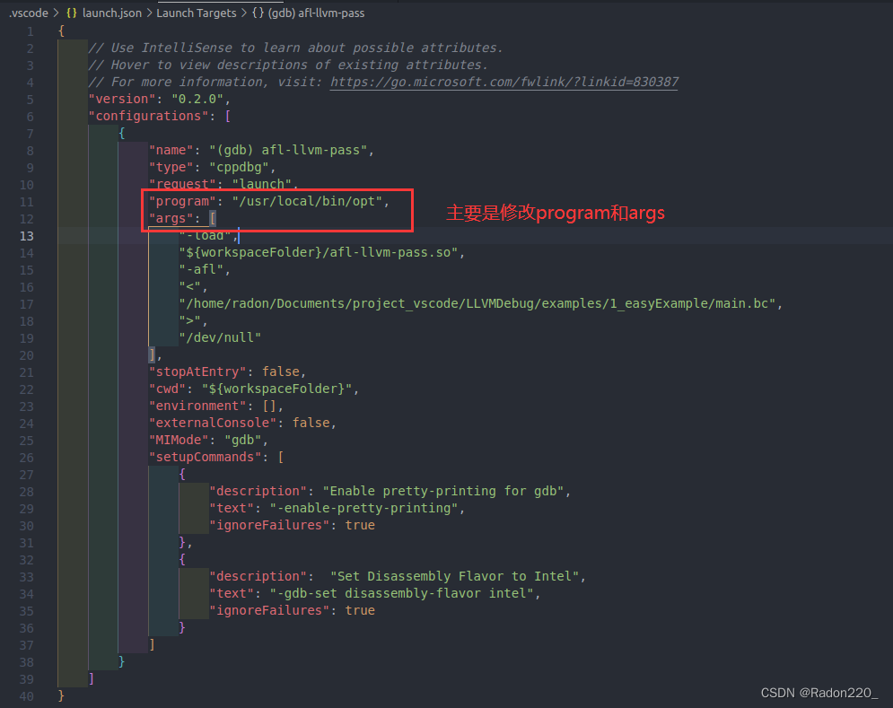
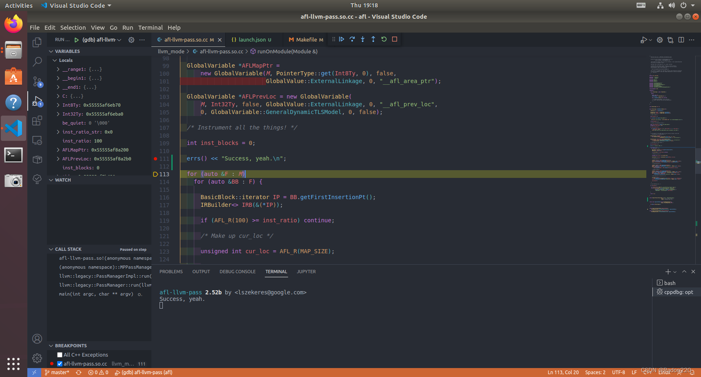

## 前言

常接触LLVM的人一定很熟悉Pass，通过编写Pass我们可以对代码进行优化，或者对代码进行各种各样的分析。然而通常都是写好Pass后生成.so文件，在构建程序的时候调用.so以调用Pass里的内容，形如`clang -g -emit-llvm -Xclang -load -Xclang path/to/mypass.so main.c -o main`。这让动态调试pass看起来很难实现，并且[官方文档](https://llvm.org/docs/WritingAnLLVMPass.html#using-gdb-with-dynamically-loaded-passes)里对使用gdb调试pass也写的不是很清楚。但实际上，在IDE里利用gdb对pass进行动态调试是可以的，本文会详细介绍调试pass的过程。

## 1. 准备工作

操作系统采用Ubuntu 18.04.6 LTS。

该[Repo](https://github.com/Radon10043/LLVMDebug)中为大家写好了一份配LLVM环境的脚本，直接进入目录运行脚本即可。

有几个注意事项：

- 在构建LLVM的指令那里，我由于自己的电脑配置不是很高，所以并行任务的数量设置为了1（`-DLLVM_PARALLEL_LINK_JOBS=1`）。如果读者对自己电脑配置有信心的话，可以尝试将并行任务数量设置多一些，这样构建起来速度会更快，如果对自己电脑的配置没有信心的话，建议并行任务的数量保持为1，否则会构建失败导致浪费时间。
- [官方文档](https://llvm.org/docs/WritingAnLLVMPass.html#using-gdb-with-dynamically-loaded-passes)的意思是，如果要对Pass进行调试，要安装Debug版本的LLVM，因此本文使用的是Debug版本的LLVM。
  - 2022年9月3日更新：Release版也可以对自己写的Pass调试，如果不需要关注LLVM的源码的话，安装Release版的LLVM就够用了。Release版与Debug版相比，所占容量更小，并且因为不需要加载调试信息，所以速度也更快。如果没有一定要安装Debug版LLVM的需求的话，建议安装Release版。
- Debug版本的LLVM容量非常大，建议预留200G以上的硬盘空间。

```bash
git clone https://github.com/Radon10043/LLVMDebug
cd LLVMDebug
sudo ./build.sh Debug  # or Release
```

构建时间通常会在一个小时以上，耐心等待即可。

## 2. 开始调试

### 2.1. 编译构建Pass

库中的passes文件夹下有一个简单的案例，是我从官方文档里复制过来的，可以拿来练练手。如果已经装了vscode与C++ Extension pack的话，直接进入passes文件夹下选好编译器（推荐g++-10）然后点击build就行了。如果没有装的话，可以进入passes文件夹下执行以下指令：

```bash
cd /path/to/LLVMDebug/passes
mkdir build
cd build
cmake ..
make
```

build/pass1下生成libPass1.so就算成功了。

### 2.2. 在终端里调试Pass

库中的examples文件夹下写了一个简单的例子，首先来编译它生成.bc文件。

```bash
cd /path/to/LLVMDebug/examples/1_easyExample
clang -g -emit-llvm -c main.c -o main.bc
```

根据官方文档的教程，我们要首先要在opt进程上启动gdb，然后在`llvm::PassManager::run`上打断点。但实际上这样做是不行的，估计是因为文档版本比较旧了，run函数早就挪到别的地方去了。正确的指令应该是这样:

```bash
# 这里Reading symbols会花一些时间
gdb opt
(gdb) break llvm::Pass::preparePassManager
```

然后再在我们写的Pass里打个断点：

```bash
break Hello::runOnFunction
# 这里可能会提示你以下内容:
# Function "Hello::runOnFunction" not defined.
# Make breakpoint pending on future shared library load? (y or [n]) y
# 输入y即可，默认是n
```

准备工作完成，现在开始试试在终端里调试我们的pass：

```bash
(gdb) run -load /path/to/LLVMDebug/passes/build/pass1/libPass1.so -hello < /path/to/LLVMDebug/examples/1_easyExample/main.bc > /dev/null
```

在终端中输入多次`c`，可以看到成功地在我们pass里打断点的位置停止了：



### 2.3. 在VSCode里动态调试Pass

在终端里调试Pass虽然也可以，但还是在IDE里调试Pass会让开发效率更高一些。既然我们已经知道了调试的指令，那么将调试指令挪到IDE里理论上就可以达成目的了。本文选择使用VSCode来动态调试Pass。

打开passes文件夹作为工作目录，点击 `Run` -> `Add Configuration`，选择`C/C++: (gdb) Launch`。

launch.json的内容如下，主要是修改`program`和`args`

```json
{
    // Use IntelliSense to learn about possible attributes.
    // Hover to view descriptions of existing attributes.
    // For more information, visit: https://go.microsoft.com/fwlink/?linkid=830387
    "version": "0.2.0",
    "configurations": [
        {
            "name": "(gdb) Launch",
            "type": "cppdbg",
            "request": "launch",
            "program": "/usr/local/bin/opt",  // 要改成自己电脑中opt所在位置
            // args里其实就是把之前在终端里调试Pass用的命令按照空格拆开然后依次放进来
            "args": [
                "-load",
                // 更改.so文件路径
                "/path/to/LLVMDebug/passes/build/pass1/libPass1.so",
                "-hello",
                "<",
                // 更改.bc文件路径
                "/path/to/LLVMDebug/examples/1_easyExample/main.bc",
                ">",
                "/dev/null"
            ],
            "stopAtEntry": false,
            "cwd": "${workspaceFolder}",
            "environment": [],
            "externalConsole": false,
            "MIMode": "gdb",
            "setupCommands": [
                {
                    "description": "Enable pretty-printing for gdb",
                    "text": "-enable-pretty-printing",
                    "ignoreFailures": true
                },
                {
                    "description":  "Set Disassembly Flavor to Intel",
                    "text": "-gdb-set disassembly-flavor intel",
                    "ignoreFailures": true
                }
            ]
        }
    ]
}
```

配置完成后，来试试效果吧。按下F5，发现可以成功在VSCode里调试Pass了



需要注意的是，当改了pass中的内容时，需要先build再进行调试，否则调试内容会和源码对不上。

### 2.4. 调试afl-llvm-pass.so.cc

AFL是一款著名的覆盖率制导的灰盒模糊测试工具，其中一种插桩方式就是用clang加载afl-llvm-pass.so来进行插桩。afl-llvm-pass.so.cc虽然代码不多，但如果不动态进行调试的话，它的插桩过程还是比较难理解的，接下来就用前面的技巧来试试对afl-llvm-pass.so进行动态调试。

笔者下载的是2.52b版本的AFL:

```bash
git clone https://github.com/mirrorer/afl
cd afl
make all
cd llvm_mode
make all
```

2.52b版本的afl/llvm_mode在Ubuntu18下可能会make failed，将afl-llvm-pass.so.cc下的RegisterAFLPass改一下参数即可。



然后，我们需要在afl-llvm-pass.so.cc中再添加一段代码，以方便我们来调试，加在`AFLCoverage::runOnModule`的下面，`registerAFLPass`的上面即可：

```cpp
// 如果不添加这段代码的话，运行过程中不会加载.so文件
static RegisterPass<AFLCoverage> X("afl", "AFLCoverage Pass",  // 之前的pass中写的是hello, 所以我们调试的指令中用的是-hello, 这里改成了afl, 我们的调试指令也要相应地改成-afl
                                 false /* Only looks at CFG */,
                                 false /* Analysis Pass */);
```

llvm_mode下的makefile中作者给编译构建.so文件添加了-O3参数，这样会让我们丢失调试过程中的一些信息，因此我们需要将makefile中的O3改为O0，来保留调试的信息。



如果不需要再调试了，那么就需要将makefile中的O0换回O3，并`make clean all`一下。注意一定要有clean，没有clean的话make后还是O0。

修改完成后，在llvm_mode文件夹下`make clean all`一下，然后按照上述的步骤设置launch.json文件。



设置完成后，来按F5调试一下看看吧。



成功！总算不用通过cout来调试了！

## 总结

虽然可以成功对自己写的Pass进行调试，但由于装的是Debug版本的LLVM，因此在速度方面有一些牺牲。近期笔者打算调研的内容如下：

- 查看安装Release版本的LLVM后能否也对自己的Pass进行动态调试
- 完善github的README文档
- 尝试对一个规模较大的C语言项目的插桩过程进行动态调试

如果有什么问题的话，欢迎在评论区留言或私信。
Repo地址：[https://github.com/Radon10043/LLVMDebug](https://github.com/Radon10043/LLVMDebug)
