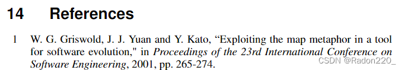
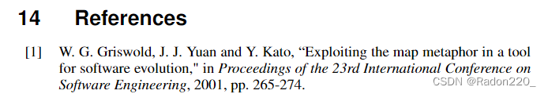

先贴一个模板下载地址：[https://digital-library.theiet.org/journals/author-guide](https://digital-library.theiet.org/journals/author-guide)

打开IET-Submission-DoubleColumn-Template.tex，加入几个参考文献后会发现默认的编号样式为仅有序号，如下：



默认的编号样式不太符合习惯，想改成类似 `[1]` 这样的，查了半天发现也没结果，于是决定自己去cta-author.cls文件里探索一下，发现在cls文件里有这样一句话：


```latex
\renewcommand\bibnumfmt[1]{{#1}}
```


看起来意思是重新定义了一下bib的编号样式，恰好bib又和参考文献密切相关，于是抱着试一试的心态注释掉了这句话，并重新编译tex文件生成了pdf，发现编号果然变成了方括号样式


