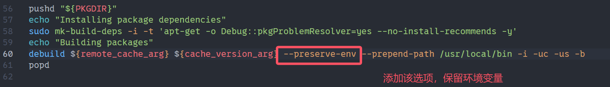
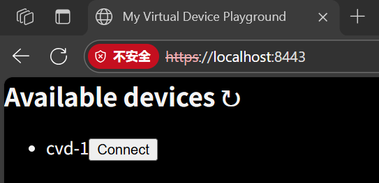
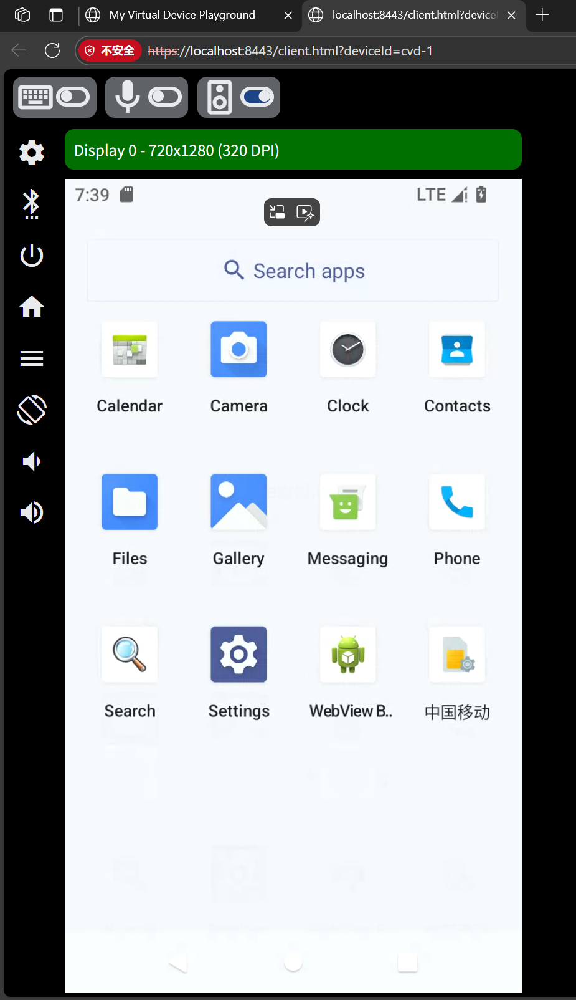
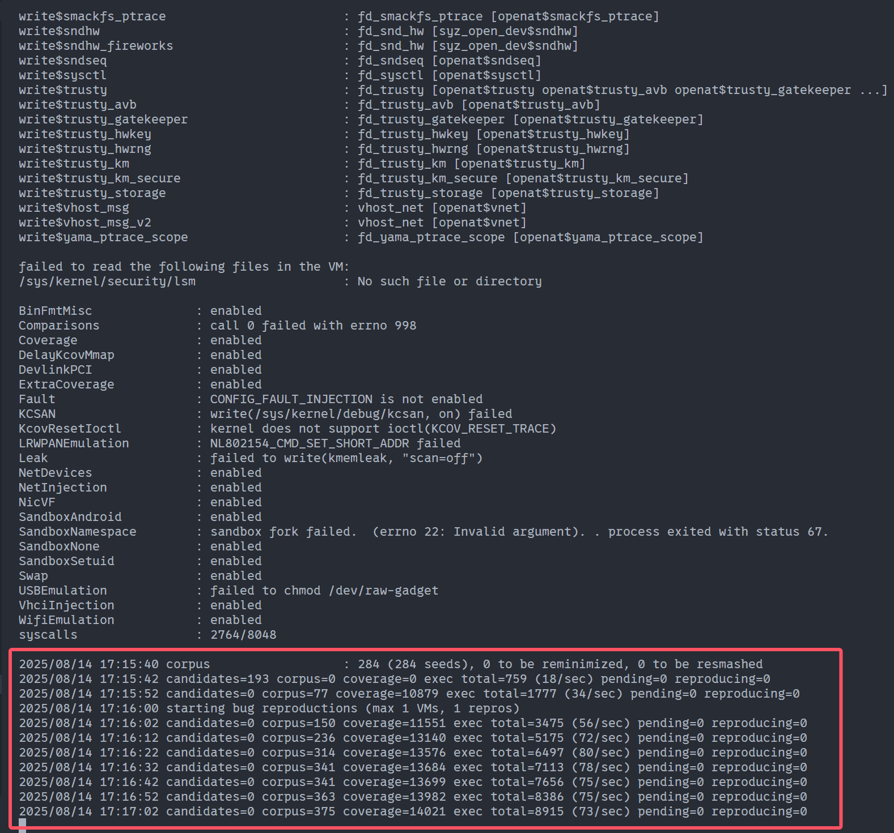

最近在研究内核模糊测试，发现google的syzkaller是现在最流行的内核fuzzer之一，支持对多种内核fuzzing。官方文档中对使用syzkaller测linux内核写的已经非常详细了，但是作为linux内核衍生品的安卓内核，关于使用syzkaller测它的资料却不多，而且syzkaller文档中的许多关于安卓的链接都404了。笔者在将syzkaller应用于测试安卓内核过程中踩了不少坑，通过这篇博客记录一下我的配置过程，希望以后可以帮到其他人。

## 更新记录

- 2025-8-14：文章发布
- 2025-8-24：修改编译安卓内核章节的部分命令错误

本文所述流程已于2025-8-20合并至syzkaller官方仓库，[链接](https://github.com/google/syzkaller/blob/master/docs/linux/setup_linux-host_android-virtual-device_x86-64-kernel.md)。

## 注意事项

为了跑通安卓内核模糊测试，我们需要安装cuttlefish，编译syzkaller、安卓内核和安卓系统镜像。编译安卓系统镜像会占用非常多空间和内存，建议电脑至少留出500G的磁盘空间，且内存在64G或以上。笔者选择在docker容器里配环境，宿主机操作系统是Ubuntu 24.04 LTS。

博文中许多操作都需要魔法上网，如何在ubuntu下为了容器配置魔法上网请自行google。

## 准备工作

### 实例化容器

镜像选择用Ubuntu 22.04。AOSP的容量非常大，建议带上`-v`参数实现将AOSP持久化存储，毕竟万一销毁容器导致几百个G的文件消失还是挺让人头疼的。

```bash
docker run --privileged \
		   --network host \
		   --name android-kernel-fuzzing \
		   -v ./vol-android-kernel-fuzzing:/vol \
		   ubuntu:22.04 tail -f /dev/null
```

通过`docker exec`进入容器：

```bash
docker exec -it android-kernel-fuzzing bash
```

### 安装依赖

进入容器后安装如下依赖：

```bash
apt update
apt install -y sudo git wget curl repo libncurses5 vim gcc make bison bc zip rsync language-pack-en-base
```

## 安装cuttlefish

参考资料：

- [github - google/android-cuttlefish](https://github.com/google/android-cuttlefish)
- [AOSP - Cuttlefish虚拟安卓设备](https://source.android.google.cn/docs/devices/cuttlefish?hl=zh-cn)
- [AOSP - 如何使用Cuttlefish](https://source.android.google.cn/docs/devices/cuttlefish/get-started?hl=zh-cn)

我们选择用cuttlefish模拟安卓设备，这也是谷歌近年来新推出的安卓设备模拟器。如果你有真实的安卓手机的话直接把它连电脑上刷机做测试也行，但是需要注意syzkaller的文档中说对真实手机做内核fuzzing可能会导致砖机。

根据google官方的教程，我们先安装cuttlefish需要的依赖：

```bash
apt install -y git devscripts equivs config-package-dev debhelper-compat golang curl
```

下载cuttlefish并进行安装，这里使用v1.16.0：

```bash
git clone https://github.com/google/android-cuttlefish
cd android-cuttlefish
git checkout v1.16.0
```

`debuild`默认不会继承环境变量，但在构建过程中我们需要保留部分变量（特别是在开了代理的情况下）。修改android-cuttlefish/tools/buildutils/build-package.sh中的第60行，添加`--preserve-env`选项来保留环境变量（注意一定要添加在`--prepend-path`前，否则脚本执行会报错）：



然后运行以下命令，耗时蛮久的，我这边等了接近1小时：

```bash
tools/buildutils/build_packages.sh
dpkg -i ./cuttlefish-base_*_*64.deb || sudo apt-get install -y -f
dpkg -i ./cuttlefish-user_*_*64.deb || sudo apt-get install -y -f
```

需要将我们当前登录的用户加入组中，初始可能没有这些组，先创建再加入：

```bash
groupadd --system kvm
groupadd --system cvdnetwork
groupadd --system render
usermod -aG kvm,cvdnetwork,render root
```

宿主机上执行命令，重启一下容器：

```bash
docker restart android-kernel-fuzzing
```

官方文档写道我们可以通过预构建的安卓通用系统镜像（GSI）来让cuttlefish模拟设备，但是预构建的GSI不兼容KASAN+KCOV构建的内核。为了能让syzkaller如期获得覆盖率和报错信息等内容，我们需要自己下载并编译GSI。

## 编译安卓系统镜像

参考资料：

- [AOSP - 下载Android源代码](https://source.android.google.cn/docs/setup/download?hl=zh-cn)
- [AOSP - 构建Android](https://source.android.google.cn/docs/setup/build/building?hl=zh-cn)
- [AOSP - 通用系统镜像](https://source.android.google.cn/docs/core/tests/vts/gsi?hl=zh-cn#building-gsis)
- [AOSP - 架构概览](https://source.android.com/docs/core/architecture?hl=zh-cn)
- [AOSP - USTC Mirror Help](https://mirrors.ustc.edu.cn/help/aosp.html)

单独只有一个安卓内核（Android Kernel）是无法构成一个可运行的安卓系统的。内核之上，我们还需要一个完整的"用户空间"（Userspace），它通常被打包成系统镜像（System Image）进行编译和刷入。关于安卓内核与安卓系统镜像之间的关系，Google官方文档中的架构图给出了清晰的展示。

简单来说，内核负责与底层的硬件进行直接通信，负责如CPU调度、内存分配、文件系统、网络通信等任务。它向系统镜像提供了一系列系统调用（syscall），使得镜像中的程序可通过syscall来间接地与底层硬件交互，避免了直接交互可能产生的潜在损害。

回到正题，我们这里选择android13的通用系统镜像（GSI），对应AOSP源码中的分支为android13-gsi。GSI占用的空间非常大，我这里下载完了总共是占用90G的空间，后续编译等操作估计会占用接近300G的空间。为了节省代理流量，这里选择用中科大软件源下载特定分支：

```bash
mkdir -p /vol/android13-gsi
cd /vol/android13-gsi
repo init --partial-clone -u https://mirrors.ustc.edu.cn/aosp/platform/manifest -b android13-gsi
repo sync -c
```

`repo init`的时候会提示用git设置user.name和user.email，根据自己的实际情况设置即可。应该还会提示更新repo，建议更一下。`repo sync`运行的时间也很久，这里也是等了1个多小时。

同步完毕后，我们可以开始构建GSI了。我们首先在`android13-gsi`目录下运行如下指令，设置构建环境：

```bash
source build/envsetup.sh
```

然后设置要构建的目标，这里推荐选择和电脑CPU一样的架构（运行`uname -m`即可查看架构）。我的是x86_64架构，因此构建目标也选择x86_64：

```bash
lunch aosp_cf_x86_64_phone-userdebug
```

执行完上述指令后终端会显示如下信息，具体内容根据每个人电脑的不同配置决定：

```
============================================
PLATFORM_VERSION_CODENAME=REL
PLATFORM_VERSION=13
TARGET_PRODUCT=aosp_cf_x86_64_phone
TARGET_BUILD_VARIANT=userdebug
TARGET_BUILD_TYPE=release
TARGET_ARCH=x86_64
TARGET_ARCH_VARIANT=silvermont
TARGET_2ND_ARCH=x86
TARGET_2ND_ARCH_VARIANT=silvermont
HOST_ARCH=x86_64
HOST_2ND_ARCH=x86
HOST_OS=linux
HOST_OS_EXTRA=Linux-6.8.0-65-generic-x86_64-Ubuntu-22.04.4-LTS
HOST_CROSS_OS=windows
HOST_CROSS_ARCH=x86
HOST_CROSS_2ND_ARCH=x86_64
HOST_BUILD_TYPE=release
BUILD_ID=TP1A.220624.019
OUT_DIR=out
PRODUCT_SOONG_NAMESPACES=device/generic/goldfish-opengl device/generic/goldfish device/generic/goldfish-opengl hardware/google/camera hardware/google/camera/devices/EmulatedCamera device/google/cuttlefish/apex/com.google.cf.wifi_hwsim external/mesa3d vendor/google_devices/common/proprietary/confirmatioui_hal
============================================
```

请注意，每次新开终端后都要执行一遍`source build/envsetup.sh`，并运行`lunch`指定要构建的目标，否则可能会导致GSI构建失败。

GSI仓库里提供了非常多的构建选项，我们这里输入的`aosp_cf_x86_64_phone-userdebug`可以这么解读：

- aosp：Android Open Source Platform，安卓开源平台
- cf：表示镜像为在cuttlefish模拟器中运行进行了优化
- x86_64：构建x86_64架构的安卓系统
- phone：表示这是为手机构建的系统
- userdebug：构建变体（Build Variant），提供了root权限和额外的调试功能

读者应该会发现还有可选目标是`aosp_cf_x86_64_only_phone-userdebug`，该目标与我们使用的目标区别是，它仅包含系统本身，不带有内核和内核模块等，启动时需要指定自己编译的内核与内核模块。这里为了方便调试，我们选择的是带有默认构建内核的目标。

执行下述指令来构建GSI：

```bash
m
```

若对自己电脑配置有信心，可通过`-j`增加线程数量，例如`m -j8`

输出的对象默认会存储在`android13-gsi/out`下。编译耗时很长，需要耐心等待，我这里是编译了2个多小时。

接下来，我们启动cuttlefish模拟一个安卓实例，看看是否编译成功。执行如下命令：

```bash
launch_cvd
```

浏览器输入`localhost:8443`，应该能看到有1个cuttlefish模拟的虚拟设备：



点击`connect`后可以任意操控虚拟设备，就像在使用真正的安卓手机一样。



终端按CTRL + C可让模拟器退出。

## 编译安卓内核

参考资料：

- [AOSP - 构建内核](https://source.android.google.cn/docs/setup/build/building-kernels?hl=zh-cn)
- [AOSP - 内核分支及其构建系统](https://source.android.google.cn/docs/setup/reference/bazel-support?hl=zh-cn)

从内核分支及其构建系统对应表中可知，android13对应的内核版本有common-android13-5.10和common-android13-5.15。不难看出前者基于linux内核v5.10开发，而后者基于v5.15。本文以common-android13-5.15为例来构建内核，同样使用中科大镜像，命令如下：

```bash
mkdir -p  /vol/common-android13-5.15
cd /vol/common-android13-5.15
export REPO_URL=https://gerrit-googlesource.proxy.ustclug.org/git-repo
repo init -u https://mirrors.ustc.edu.cn/aosp/kernel/manifest -b common-android13-5.15
repo sync -c
```

内核仓库的同步就比GSI快多了。接下来我们构建x86_64架构的安卓内核，common-android13-5.15支持使用kleaf构建和使用build.sh构建，我们这里选择使用build.sh。

为了后续syzkaller测试时能收集内核代码覆盖和检测触发漏洞的相关信息，我们需要在启用KASAN+KCOV的前提下构建安卓内核。

注意到common-android13-5.15/common下存在文件build.config.gki_kasan.x86_64，不难想到这是构建x86_64内核且开启kasan的配置。我们在内核仓库根目录下执行如下命令编译内核，建议加上`LTO=none`提高编译速度：

```bash
BUILD_CONFIG=common/build.config.gki_kasan.x86_64 LTO=none build/build.sh
```

编译完毕后，在out/android13-5.15/dist下应该能发现bzImage和vmlinux文件，这就是我们编译好的内核文件。我们还需要基于KASAN+KCOV编译内核模块，否则带有KASAN+KCOV的内核会与普通的内核模块不兼容，导致设备启动失败。

```bash
BUILD_CONFIG=common-modules/virtual-device/build.config.virtual_device_kasan.x86_64 LTO=none build/build.sh
```

## 编译syzkaller

参考资料：

- [github - google/syzkaller](https://github.com/google/syzkaller)

syzkaller的编译就简单多了，我们新开个终端进入容器，避免被GSI的环境影响到。

虽然先前cuttlefish安装过程中已经为我们安装了go，但是版本较旧（1.18）无法成功编译syzkaller，我们这里再装个新版本的go（1.23.6）：

```bash
cd /vol
wget -nc https://go.dev/dl/go1.23.6.linux-amd64.tar.gz
tar -C /usr/local -xzf go1.23.6.linux-amd64.tar.gz
rm go1.23.6.linux-amd64.tar.gz
# 将新版本go所在目录放在$PATH的前面，这样在终端输入go会优先调用新版本的
echo -e "\nexport PATH=/usr/local/go/bin:$PATH" >> ~/.bashrc
exec bash
```

下载和编译syzkaller：

```bash
git clone https://github.com/google/syzkaller
cd syzkaller
make
```

## syzkaller测试安卓内核

### 启动安卓虚拟设备

使用android13-gsi的`launch_cvd`指令启动虚拟设备，解释一下几个参数：

- -daemon：后台运行
- -kernel_path：指定内核路径
- -initramfs_path：指定initramfs.img的路径，用于加载内核模块用
- -num_instances：同时启动的设备数量，默认是1，可以多开几个，提高syzkaller的测试效率，为简单起见这里就开一个。

```bash
cd /vol/android13-gsi
source build/envsetup.sh
lunch aosp_cf_x86_64_phone-userdebug
launch_cvd -daemon -kernel_path=/vol/common-android13-5.15/out/android13-5.15/dist/bzImage -initramfs_path=/vol/common-android13-5.15/out/android13-5.15/dist/initramfs.img
```

使用adb连接模拟器，看能不能连上，第一个虚拟设备的端口号是6520，往后依次加一，如果同时开启4个设备的话，他们的端口号就依次是6520、6521、6522和6523：

```bash
adb connect 0.0.0.0:6520
```

不出意外的话应该会提示成功连接。使用以下指令列出可识别到的设备：

```bash
adb devices
```

### 启动syzkaller

最后就是用syzkaller来测试安卓内核了，在syzkaller根目录下创建workdir/android/test.cfg，内容如下：

```json
{
	"target": "linux/amd64",
	"http": "127.0.0.1:56741",
	"workdir": "/vol/syzkaller/workdir/android/out",
	"kernel_obj": "/vol/common-android13-5.15/out/android13-5.15/dist",
	"syzkaller": "/vol/syzkaller",
	"cover": true,
	"type": "adb",
	"vm": {
		"devices": ["0.0.0.0:6520"],
		"battery_check": true
	}
}
```

在启用cvd的前提下运行syzkaller：

```bash
/vol/syzkaller/bin/syz-manager -config=/vol/syzkaller/workdir/android/test.cfg
```

终端上应该可以看到syzkaller在测试过程中的输出信息了，并且还能看到覆盖信息：



觉得差不多了，可以CTRL+C停掉syzkaller，再运行`stop_cvd`关掉模拟器：

```bash
stop_cvd
```

## 结语

配这个环境还挺复杂的，笔者在这上面投入了接近两周的时间，感觉像是回到了几年前第一次接触配环境。本文还是利用build.sh来构建内核，不过看google官方文档的意思是未来该方法会慢慢废弃，转为用kleaf，因此未来笔者应该会研究一下如何用kleaf自定义内核配置并尝试在更高版本的安卓内核上跑通syzkaller。

自己也是第一次接触安卓相关的内容，如果文章哪里存在用词不准确，欢迎指正。
